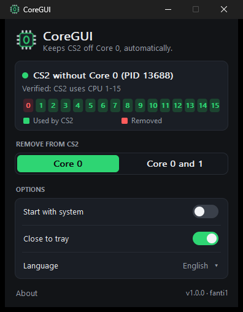

  <a href="README.md">English</a> ·
  <a href="README.pt-BR.md">Português</a> ·
  <b>Español</b> ·
  <a href="README.ru.md">Русский</a> ·
  <a href="README.zh-CN.md">简体中文</a>

  

<h1 align="center">CoreGUI</h1>

  <b>Saca a Counter-Strike 2 del Core 0. Automáticamente.</b> 
  Alternativa gratuita y de código abierto a Process Lasso para CS2.

  

  
  
  

  

---

## ¿Qué hace?

Windows hace la mayor parte de su trabajo en segundo plano en el primer núcleo del procesador, el
**Core 0**. Muchos jugadores apartan CS2 de él, pero hacerlo a mano obliga a abrir el Administrador de
tareas **cada vez que se inicia el juego**.

**CoreGUI lo hace por ti.** Déjalo funcionando junto al reloj (bandeja del sistema). Cada vez que abras CS2,
saca el juego del Core 0 (o de los Cores 0 y 1) y le deja usar todos los demás núcleos.

## Cómo usarlo

1. **[Descarga `coregui.exe`](https://github.com/fanti1/core-gui/releases/latest/download/coregui.exe)** y ábrelo. No hace falta instalar nada.
2. Elige **Core 0** o **Core 0 y 1**. Si no estás seguro, deja **Core 0**.
3. Juega. Puedes cerrar la ventana: CoreGUI sigue funcionando en la bandeja, junto al reloj.

Los cuadritos muestran los núcleos de tu procesador: **verde** = usado por CS2, **rojo** = quitado.
El punto de arriba se pone **verde** cuando CS2 está abierto y el cambio se ha confirmado.

Activa **Iniciar con el sistema** para que se abra solo (oculto en la bandeja) cada vez que enciendas el PC.

> **¿Aparece "Windows protegió su PC"?** Ese aviso sale en aplicaciones nuevas que aún no tienen firma
> de pago. Haz clic en **Más información → Ejecutar de todas formas**. La aplicación es de código abierto y
> cada versión se compila públicamente en GitHub ([cómo comprobarlo](docs/TECHNICAL.md#check-it-yourself)).

## ¿Es seguro?

- **No toca el juego.** Nunca lee ni cambia la memoria ni los archivos de CS2. Solo cambia el mismo ajuste
  de Windows que puedes cambiar a mano en **Administrador de tareas → Detalles → clic derecho en cs2.exe →
  Establecer afinidad**.
- **No ralentiza tu PC.** Usa alrededor del **0,01 % de un núcleo** mientras juegas y **unos 13 MB de RAM**.
- **Privado.** Sin conexión a internet, sin anuncios, sin recopilación de datos.
- **Código abierto.** Cualquiera puede leer el código. Todos los detalles, bit a bit, están en la
  [página técnica](docs/TECHNICAL.md) (en inglés).

## Preguntas

**¿Hará que mi juego vaya más rápido?**
Depende de tu PC. Muchos jugadores usan este ajuste, pero los resultados varían: pruébalo y quédate con lo
que mejor te funcione.

**¿Cómo lo desinstalo?**
Desactiva *Iniciar con el sistema*, haz clic derecho en el icono de la bandeja, elige **Salir** y borra
`coregui.exe`. Eso es todo.

**¿Funciona en Linux?**
Sí. Descarga `coregui-linux-amd64` desde la [página de versiones](https://github.com/fanti1/core-gui/releases/latest).
En Linux funciona como icono en la bandeja, con las mismas opciones.

**¿Qué idiomas tiene?**
English, Português, Español, Русский, Українська, Deutsch, Français, Polski, Türkçe y 简体中文.
Elige automáticamente el idioma de tu sistema.

## Aviso legal

CoreGUI es un proyecto independiente, **sin relación con Valve**. Solo cambia un ajuste estándar de Windows
y nunca toca el juego, pero **solo Valve decide sus reglas antitrampas**, y pueden cambiar en cualquier
momento. **Úsalo bajo tu propia responsabilidad.** El software se ofrece "tal cual", sin ninguna garantía.

## Licencia

Copyright (C) 2026 [fanti1](https://github.com/fanti1). Con licencia [GNU GPL v3](LICENSE).
Puedes usar, estudiar, modificar y compartir CoreGUI gratis. Si compartes una versión modificada, debe
mantener el crédito y seguir siendo de código abierto con la misma licencia.

---

  <a href="docs/TECHNICAL.md">Detalles técnicos</a> ·
  <a href="https://github.com/fanti1/core-gui/releases">Todas las versiones</a> ·
  Creado por <a href="https://github.com/fanti1">fanti1</a>

