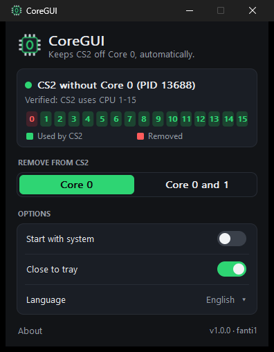

  <b>English</b> ·
  <a href="README.pt-BR.md">Português</a> ·
  <a href="README.es.md">Español</a> ·
  <a href="README.ru.md">Русский</a> ·
  <a href="README.zh-CN.md">简体中文</a>

  

<h1 align="center">CoreGUI</h1>

  <b>Keeps Counter-Strike 2 off Core 0. Automatically.</b> 
  Free and open-source alternative to Process Lasso for CS2.

  

  
  
  

  

---

## What does it do?

Windows does most of its background work on the first core of your processor, **Core 0**. Many players
move CS2 away from it, but doing that by hand means opening Task Manager **every time the game starts**.

**CoreGUI does it for you.** Leave it running next to the clock (system tray). Every time you open CS2, it
moves the game off Core 0 (or Cores 0 and 1) and lets it use all the other cores.

## How to use

1. **[Download `coregui.exe`](https://github.com/fanti1/core-gui/releases/latest/download/coregui.exe)** and open it. No installation needed.
2. Pick **Core 0** or **Core 0 and 1**. If you are not sure, keep **Core 0**.
3. Play. You can close the window: CoreGUI keeps working from the tray, next to the clock.

The little squares show your processor's cores: **green** = used by CS2, **red** = removed. The dot at the
top turns **green** when CS2 is open and the change is confirmed.

Turn on **Start with system** so it starts by itself (hidden in the tray) every time you turn on your PC.

> **"Windows protected your PC"?** That warning shows up for new apps that are not paid-signed yet.
> Click **More info → Run anyway**. The app is open source and every release is built in public
> by GitHub ([how to check](docs/TECHNICAL.md#check-it-yourself)).

## Is it safe?

- **It does not touch the game.** It never reads or changes CS2's memory or files. It only changes the
  same Windows setting you can change by hand in **Task Manager → Details → right-click cs2.exe → Set
  affinity**.
- **It does not slow down your PC.** It uses about **0.01% of one core** while you play and **about 13 MB
  of RAM**.
- **Private.** No internet connection, no ads, no data collection.
- **Open source.** Anyone can read the code. Every detail, bit by bit, is in the
  [technical page](docs/TECHNICAL.md).

## Questions

**Will it make my game faster?**
It depends on your PC. Many players use this tweak, but results vary: test it yourself and keep what
works for you.

**How do I uninstall it?**
Turn off *Start with system*, right-click the tray icon and choose **Exit**, then delete `coregui.exe`.
That's it.

**Does it work on Linux?**
Yes. Download `coregui-linux-amd64` from the [releases page](https://github.com/fanti1/core-gui/releases/latest).
On Linux it runs as a tray icon with the same options.

**Which languages?**
English, Português, Español, Русский, Українська, Deutsch, Français, Polski, Türkçe and 简体中文.
It picks your system's language automatically.

## Disclaimer

CoreGUI is an independent project, **not affiliated with Valve**. It only changes a standard Windows
setting and never touches the game, but **only Valve decides its anti-cheat rules**, and they can change at
any time. **Use it at your own risk.** The software is provided "as is", without any warranty.

## License

Copyright (C) 2026 [fanti1](https://github.com/fanti1). Licensed under the [GNU GPL v3](LICENSE).
You can use, study, change and share CoreGUI for free. If you share a modified version, it must keep the
credit and stay open source under the same license.

---

  <a href="docs/TECHNICAL.md">Technical details</a> ·
  <a href="https://github.com/fanti1/core-gui/releases">All releases</a> ·
  Created by <a href="https://github.com/fanti1">fanti1</a>

