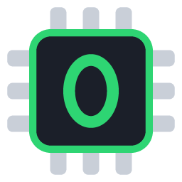
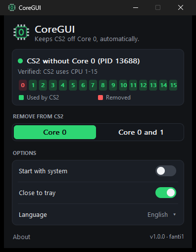

  <a href="README.md">English</a> ·
  <b>Português</b> ·
  <a href="README.es.md">Español</a> ·
  <a href="README.ru.md">Русский</a> ·
  <a href="README.zh-CN.md">简体中文</a>

  

<h1 align="center">CoreGUI</h1>

  <b>Tira o Core 0 do Counter-Strike 2. Automaticamente.</b> 
  Alternativa gratuita e open source ao Process Lasso para o CS2.

  

  
  
  

  

---

## O que ele faz?

O Windows faz a maior parte do trabalho de fundo no primeiro núcleo do processador, o **Core 0**. Muitos
jogadores tiram o CS2 dele, mas fazer isso na mão exige abrir o Gerenciador de Tarefas **toda vez que o
jogo abre**.

**O CoreGUI faz isso por você.** Deixe ele rodando ao lado do relógio (na bandeja). Toda vez que você abrir
o CS2, ele tira o jogo do Core 0 (ou dos Cores 0 e 1) e deixa o jogo usar todos os outros núcleos.

## Como usar

1. **[Baixe o `coregui.exe`](https://github.com/fanti1/core-gui/releases/latest/download/coregui.exe)** e abra. Não precisa instalar.
2. Escolha **Core 0** ou **Core 0 e 1**. Na dúvida, deixe **Core 0**.
3. Jogue. Pode fechar a janela: o CoreGUI continua funcionando na bandeja, ao lado do relógio.

Os quadradinhos mostram os núcleos do seu processador: **verde** = usado pelo CS2, **vermelho** = removido.
A bolinha no topo fica **verde** quando o CS2 está aberto e a mudança foi confirmada.

Ative **Iniciar com o sistema** para ele abrir sozinho (escondido na bandeja) toda vez que você ligar o PC.

> **Apareceu "O Windows protegeu o computador"?** Esse aviso aparece em apps novos que ainda não têm
> assinatura paga. Clique em **Mais informações → Executar assim mesmo**. O app é open source e cada
> versão é compilada publicamente pelo GitHub ([como conferir](docs/TECHNICAL.md#check-it-yourself)).

## É seguro?

- **Não mexe no jogo.** Nunca lê nem altera a memória ou os arquivos do CS2. Ele só muda a mesma
  configuração do Windows que você mudaria na mão em **Gerenciador de Tarefas → Detalhes → clique
  direito em cs2.exe → Definir afinidade**.
- **Não deixa o PC lento.** Usa cerca de **0,01% de um núcleo** enquanto você joga e **cerca de 13 MB de
  RAM**.
- **Privado.** Sem internet, sem anúncios, sem coleta de dados.
- **Código aberto.** Qualquer pessoa pode ler o código. Todos os detalhes, bit a bit, estão na
  [página técnica](docs/TECHNICAL.md) (em inglês).

## Perguntas

**Vai deixar meu jogo mais rápido?**
Depende do seu PC. Muitos jogadores usam esse ajuste, mas o resultado varia: teste e fique com o que
funcionar melhor para você.

**Como desinstalo?**
Desative *Iniciar com o sistema*, clique com o botão direito no ícone da bandeja, escolha **Sair** e apague
o `coregui.exe`. Só isso.

**Funciona no Linux?**
Sim. Baixe o `coregui-linux-amd64` na [página de versões](https://github.com/fanti1/core-gui/releases/latest).
No Linux ele roda como ícone na bandeja, com as mesmas opções.

**Quais idiomas?**
English, Português, Español, Русский, Українська, Deutsch, Français, Polski, Türkçe e 简体中文.
Ele escolhe o idioma do seu sistema automaticamente.

## Aviso

O CoreGUI é um projeto independente, **sem vínculo com a Valve**. Ele só muda uma configuração padrão do
Windows e nunca mexe no jogo, mas **as regras de anti-cheat são decididas apenas pela Valve** e podem mudar
a qualquer momento. **Use por sua conta e risco.** O software é fornecido "como está", sem nenhuma garantia.

## Licença

Copyright (C) 2026 [fanti1](https://github.com/fanti1). Licenciado sob a [GNU GPL v3](LICENSE).
Você pode usar, estudar, modificar e compartilhar o CoreGUI de graça. Se compartilhar uma versão modificada,
ela precisa manter o crédito e continuar open source, sob a mesma licença.

---

  <a href="docs/TECHNICAL.md">Detalhes técnicos</a> ·
  <a href="https://github.com/fanti1/core-gui/releases">Todas as versões</a> ·
  Criado por <a href="https://github.com/fanti1">fanti1</a>

