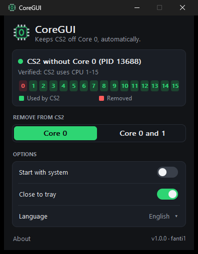

  <a href="README.md">English</a> ·
  <a href="README.pt-BR.md">Português</a> ·
  <a href="README.es.md">Español</a> ·
  <b>Русский</b> ·
  <a href="README.zh-CN.md">简体中文</a>

  

<h1 align="center">CoreGUI</h1>

  <b>Убирает Core 0 у Counter-Strike 2. Автоматически.</b> 
  Бесплатная альтернатива Process Lasso для CS2 с открытым исходным кодом.

  

  
  
  

  

---

## Что делает программа?

Windows выполняет большую часть фоновой работы на первом ядре процессора — **Core 0**. Многие игроки
убирают CS2 с этого ядра, но вручную это приходится делать через Диспетчер задач **при каждом запуске
игры**.

**CoreGUI делает это за вас.** Оставьте программу работать рядом с часами (в трее). Каждый раз, когда вы
запускаете CS2, она убирает игру с Core 0 (или с Core 0 и 1) и оставляет ей все остальные ядра.

## Как пользоваться

1. **[Скачайте `coregui.exe`](https://github.com/fanti1/core-gui/releases/latest/download/coregui.exe)** и запустите. Установка не нужна.
2. Выберите **Core 0** или **Core 0 и 1**. Если не уверены, оставьте **Core 0**.
3. Играйте. Окно можно закрыть: CoreGUI продолжит работать в трее, рядом с часами.

Квадратики показывают ядра процессора: **зелёные** — используются CS2, **красные** — убраны. Точка вверху
становится **зелёной**, когда CS2 запущена и изменение подтверждено.

Включите **Запускать вместе с системой**, чтобы программа запускалась сама (скрытой в трее) при каждом
включении ПК.

> **Появилось «Система Windows защитила ваш компьютер»?** Такое предупреждение показывается для новых
> программ без платной подписи. Нажмите **Подробнее → Выполнить в любом случае**. Код программы открыт,
> а каждая версия собирается публично на GitHub ([как проверить](docs/TECHNICAL.md#check-it-yourself)).

## Это безопасно?

- **Программа не трогает игру.** Она никогда не читает и не изменяет память или файлы CS2. Она меняет
  только ту же настройку Windows, которую можно изменить вручную: **Диспетчер задач → Подробности → правый
  клик по cs2.exe → Задать сходство**.
- **Не замедляет ПК.** Во время игры использует около **0,01% одного ядра** и **около 13 МБ ОЗУ**.
- **Приватно.** Без интернета, без рекламы, без сбора данных.
- **Открытый код.** Любой может прочитать код. Все детали, вплоть до битов, — на
  [технической странице](docs/TECHNICAL.md) (на английском).

## Вопросы

**Игра станет быстрее?**
Зависит от вашего ПК. Многие игроки используют эту настройку, но результат бывает разным: проверьте сами и
оставьте то, что работает лучше.

**Как удалить?**
Выключите *Запускать вместе с системой*, нажмите правой кнопкой на значок в трее, выберите **Выход** и
удалите `coregui.exe`. Всё.

**Работает в Linux?**
Да. Скачайте `coregui-linux-amd64` на [странице релизов](https://github.com/fanti1/core-gui/releases/latest).
В Linux программа работает как значок в трее с теми же настройками.

**Какие языки?**
English, Português, Español, Русский, Українська, Deutsch, Français, Polski, Türkçe и 简体中文.
Язык системы выбирается автоматически.

## Отказ от ответственности

CoreGUI — независимый проект, **не связанный с Valve**. Программа меняет только стандартную настройку
Windows и никогда не трогает игру, но **правила античита определяет только Valve**, и они могут измениться
в любой момент. **Используйте на свой страх и риск.** Программа предоставляется «как есть», без каких-либо
гарантий.

## Лицензия

Copyright (C) 2026 [fanti1](https://github.com/fanti1). Распространяется по лицензии [GNU GPL v3](LICENSE).
CoreGUI можно бесплатно использовать, изучать, изменять и распространять. Изменённая версия при
распространении должна сохранять указание автора и оставаться открытой под той же лицензией.

---

  <a href="docs/TECHNICAL.md">Технические детали</a> ·
  <a href="https://github.com/fanti1/core-gui/releases">Все релизы</a> ·
  Автор: <a href="https://github.com/fanti1">fanti1</a>

