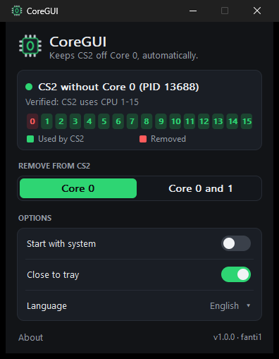

  <a href="README.md">English</a> ·
  <a href="README.pt-BR.md">Português</a> ·
  <a href="README.es.md">Español</a> ·
  <a href="README.ru.md">Русский</a> ·
  <b>简体中文</b>

  

<h1 align="center">CoreGUI</h1>

  <b>让反恐精英 2（CS2）自动避开 Core 0。</b> 
  免费、开源的 Process Lasso 替代工具，专为 CS2 打造。

  

  
  
  

  

---

## 它能做什么？

Windows 的大部分后台工作都在处理器的第一个核心 **Core 0** 上进行。很多玩家会让 CS2 避开这个核心，
但手动操作需要**每次启动游戏**都打开任务管理器。

**CoreGUI 帮你自动完成。** 让它在时钟旁边（系统托盘）运行即可。每次打开 CS2，它都会让游戏避开
Core 0（或 Core 0 和 1），并使用其余所有核心。

## 使用方法

1. **[下载 `coregui.exe`](https://github.com/fanti1/core-gui/releases/latest/download/coregui.exe)** 并打开，无需安装。
2. 选择 **Core 0** 或 **Core 0 和 1**。不确定的话，保持 **Core 0** 即可。
3. 开始游戏。可以关闭窗口：CoreGUI 会在时钟旁的托盘中继续工作。

小方块代表处理器的各个核心：**绿色** = CS2 正在使用，**红色** = 已移除。CS2 运行且设置已确认时，
顶部的圆点会变成**绿色**。

开启 **开机自启**，每次开机时它都会自动启动（隐藏在托盘中）。

> **出现"Windows 已保护你的电脑"？** 尚未购买代码签名的新软件都会出现这个提示。
> 点击 **更多信息 → 仍要运行** 即可。本软件完全开源，每个版本都由 GitHub 公开编译
> （[如何验证](docs/TECHNICAL.md#check-it-yourself)）。

## 安全吗？

- **不碰游戏。** 从不读取或修改 CS2 的内存或文件。它只修改一个 Windows 设置，和你在
  **任务管理器 → 详细信息 → 右键 cs2.exe → 设置相关性** 中手动修改的完全一样。
- **不拖慢电脑。** 游戏时仅占用约 **0.01% 的单核 CPU** 和约 **13 MB 内存**。
- **保护隐私。** 不联网、无广告、不收集任何数据。
- **开源。** 任何人都可以查看代码。所有技术细节（精确到每一位）见
  [技术说明](docs/TECHNICAL.md)（英文）。

## 常见问题

**能让游戏更流畅吗？**
取决于你的电脑。很多玩家都在用这个设置，但效果因机器而异：请自行测试，选择最适合你的方式。

**怎么卸载？**
关闭 *开机自启*，右键托盘图标选择 **退出**，然后删除 `coregui.exe` 即可。

**支持 Linux 吗？**
支持。在 [发布页面](https://github.com/fanti1/core-gui/releases/latest) 下载 `coregui-linux-amd64`。
在 Linux 上它以托盘图标运行，选项相同。

**支持哪些语言？**
English、Português、Español、Русский、Українська、Deutsch、Français、Polski、Türkçe 和简体中文，
会自动使用你的系统语言。

## 免责声明

CoreGUI 是独立项目，**与 Valve 公司无关**。它只修改一个标准的 Windows 设置，从不接触游戏，但
**反作弊规则完全由 Valve 决定**，并可能随时变化。**使用风险由你自行承担。** 本软件按"原样"提供，
不附带任何担保。

## 许可证

Copyright (C) 2026 [fanti1](https://github.com/fanti1)。基于 [GNU GPL v3](LICENSE) 许可证发布。
你可以免费使用、研究、修改和分享 CoreGUI。分享修改后的版本时，必须保留原作者署名，
并以相同许可证继续开源。

---

  <a href="docs/TECHNICAL.md">技术说明</a> ·
  <a href="https://github.com/fanti1/core-gui/releases">所有版本</a> ·
  作者 <a href="https://github.com/fanti1">fanti1</a>

